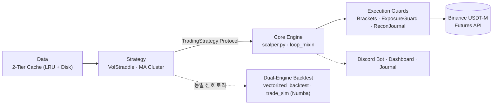

<picture>
  <source media="(prefers-color-scheme: dark)" srcset="docs/images/brand/wordmark-dark.svg">
  
</picture>

[English](README.md) | **한국어**

**바이낸스 USDT-M 선물 변동성 압축(VR Squeeze) 및 MA 클러스터 돌파 트레이딩 시스템 — Numba 백테스트와 실거래가 동일 코드 경로에서 동작합니다.**

[](https://github.com/younghwan91/quantbox/actions/workflows/ci.yml)
[](https://www.python.org/downloads/)
[](LICENSE)
[](https://www.linkedin.com/in/younghwan-chae/)

> 교육·연구 목적의 코드입니다. 실행 결과를 수익의 근거로 삼지 않습니다. 전략별 파라미터는 [docs/STRATEGIES.md](docs/STRATEGIES.md)와 `quantbox/strategy/*/config.py`에 있습니다.

- **이중 변동성 돌파 신호**: `VolStraddle` (15m/1h/4h VR 압축 + `D_mom8` / `S_d8` 스트래들)과 `MA Cluster Squeeze` (4h SMA 20/50/100/200 수렴 돌파)가 슬롯 풀을 공유합니다.
- **실거래/백테스트 일체형**: 동일한 `TradingStrategy` Protocol 기반 신호 로직이 Numba 가속 듀얼 백테스트 엔진(`vectorized_backtest.py`, `trade_sim.py`)과 페이퍼·실거래 엔진에서 실행됩니다.
- **다층 실거래 안전장치**: 서버사이드 STOP 브라켓, Limit Chaser, Market Fallback 검증, Max Drawdown Breaker, Daily Loss Limit, ExposureGuard, SQLite `ReconJournal`을 내장합니다.
- **운영 가시성**: Streamlit 실시간 대시보드, 트레이드 저널 CLI, Discord 양방향 봇·웹훅 알림을 지원합니다.

---

## 설치 및 빠른 시작

```bash
git clone https://github.com/younghwan91/quantbox.git
cd quantbox

uv sync          # uv 권장 (Python 3.13+)
# 또는: pip install -e .
```

### 환경변수 설정

API 키·디스코드 토큰·웹훅 URL·채널 ID는 코드나 git에 두지 않고 환경변수(`.env`)에서만 읽습니다. 필수 값이 없거나 `.env.example`의 자리표시자(`your_...`) 그대로면 설정 검증이 시작을 거부합니다(페이퍼 모드 포함). 백테스트와 테스트는 환경변수 없이 실행됩니다.

```bash
cp .env.example .env   # BINANCE_API_KEY, BINANCE_API_SECRET 등 입력 (.env는 gitignored)
```

### 페이퍼 트레이딩 실행

```bash
# 페이퍼 트레이딩 (시뮬레이션, 주문 없음)
python -m quantbox.scalper --strategy vol_straddle --paper

# 한 사이클만 실행
python -m quantbox.scalper --strategy vol_straddle --paper --once
```

실거래는 `--paper` 없이 실행하며 실주문이 나갑니다. 실거래 전에 Binance Hedge Mode를 켜고 `.env`를 채워야 합니다. 자세한 설정은 [MANUAL.md](MANUAL.md)를 참조하세요.

### 라이브 대시보드 & 저널 CLI

```bash
bash scripts/start_dashboard.sh start   # 백그라운드 시작 (http://localhost:8501, 30초 자동 새로고침)
bash scripts/start_dashboard.sh status  # 상태 확인
bash scripts/start_dashboard.sh stop    # 중지

python3 scripts/journal.py              # 오늘 트레이드 + 전체 요약
python3 scripts/journal.py symbols      # 심볼별 손익 랭킹
python3 scripts/journal.py last 10      # 최근 10건
python3 scripts/journal.py strategy     # 전략별 성과
```

---

## 아키텍처 개요



---

## 전략 · 안전장치 · 백테스팅

<details>
<summary>전략 구성 — VolStraddle, MA Cluster Squeeze, 레거시 전략</summary>

### VolStraddle — VR 압축 감지
- **Volatility Ratio(VR) 압축 감지**: 단기 ATR 대 장기 ATR 비율이 임계값 밑으로 내려가면 변동성 압축으로 봅니다.
- **멀티 타임프레임**: 15m/1h/4h 신호를 독립으로 보고 높은 타임프레임을 우선합니다.
- **D_mom8**: 압축 신호가 나오면 8바 모멘텀 방향으로 단방향 진입합니다.
- **S_d8 스트래들**: 압축이 일정 바 수 지속되면 양방향 동시 진입합니다(Hedge Mode).
- **청산**: 손절, 안전 상한 익절, 트레일링 스탑, 최대 보유 시간.
- **룩어헤드 방지**: 완성된 바만 참조하고 진행 중인 바는 제외합니다.

### MA Cluster Squeeze — 4h 이동평균 수렴 돌파
- **MA 클러스터 감지**: SMA(20/50/100/200) 4선이 좁게 수렴한 상태가 일정 시간 이어진 뒤의 돌파를 포착합니다.
- **4h 전용**: 상위 타임프레임에서만 동작하고 VR 신호와 거의 겹치지 않습니다.
- **방향 및 필터**: 클러스터를 벗어나는 쪽의 모멘텀 방향으로 진입하며, 너무 오래된 클러스터와 약한 모멘텀 신호를 차단합니다.

### 레거시 전략 (비프로덕션)
- **Rubber Band Scalper**: ATR 적응형 평균회귀, 거래량 클라이맥스 필터 (`quantbox/strategy/rubberband/`).

</details>

<details>
<summary>데이터 관리 및 실거래 안전장치</summary>

### 데이터 관리
- **2단계 캐싱**: 메모리(LRU) + 디스크(압축).
- **멀티 타임프레임**: 1m, 5m, 15m, 1h, 4h, 1d.
- **바이낸스 연동**: 호출 제한과 배치 처리.

### 실거래 안전장치
- **서버사이드 손절**: 바이낸스 STOP 주문으로 클라이언트 크래시·네트워크 단절에도 손절을 보장합니다.
- **레버리지 검증**: 레버리지 설정에 실패하면 주문을 중단합니다.
- **Limit Chaser & Market Fallback 검증**: 지정가 추격 주문으로 슬리피지를 줄이고, ACK 응답 감지 시 재조회해 유령 체결을 막습니다.
- **상태 영속화**: 포지션 상태를 JSON으로 저장해 크래시 뒤 거래소와 대조해 복구합니다.
- **Max Drawdown Breaker · Daily Loss Limit**: 세션 고점 대비 낙폭과 일일 손실 한도를 넘으면 청산·신규 진입을 멈춥니다.
- **Consecutive Error Guard · Close Failure Retention**: 연속 에러 시 전체 청산, 청산 실패 시 슬롯을 유지해 재시도합니다.
- **Rate Limiter + Circuit Breaker · In-Flight Order Tracker**: API 호출 제한과 미체결 주문을 추적합니다.
- **ExposureGuard · ReconJournal · Config Validators**: 세션 노출도 상한, SQLite 감사 로그, 설정 교차 검증(SL<TP, 레버리지≥1).
- **Discord Bot**: 원격 모니터링과 명령(포지션 조회, 강제 청산 등).

</details>

<details>
<summary>백테스팅 (Dual-Engine)</summary>

- **Signal-Array Engine** (`vectorized_backtest.py`): ±1 포지션 어레이 기반 단일자산 신속 스캔.
- **Trade-Event Engine** (`trade_sim.py`): 이산 트레이드 시뮬레이션. High/Low 기반 인트라바 SL/TP, N-슬롯 포트폴리오 경합, Numba 가속. `sim_directional_trades()` / `sim_straddle_trades()` → `collect_trades()` → `portfolio_sim()` → `compute_metrics()` 순서로 사용합니다.
- **롤링 윈도우 & 지표**: Formation/Trading 기간 시뮬레이션, Sharpe, Sortino, Calmar, Profit Factor, Bootstrap CI.

</details>

---

## 테스트 및 프로젝트 구조

```bash
uv run pytest tests/ -v
```

| 경로 | 설명 |
|---|---|
| `quantbox/core/` | 설정(`pydantic-settings`), 이벤트 루프, 상태 영속화, 레이트 리미터, Discord 커맨드, 트레이드 저널 |
| `quantbox/execution/` | 서버사이드 브라켓, 포지션, 거래소 대조, 미체결 추적, 노출 상한, 프리플라이트, 리스크 가드 |
| `quantbox/data/` | 바이낸스 다운로더, 2단계 캐시, 데이터 로더 |
| `quantbox/strategy/` | `vol_straddle`(VR 압축 + MA 클러스터), `rubberband`(레거시), `vol_selector`, `TradingStrategy` Protocol |
| `quantbox/backtest/` | `vectorized_backtest`(시그널 어레이), `trade_sim`(트레이드 이벤트) |
| `quantbox/notifications/` | Discord 봇(양방향)·웹훅(단방향) |
| `quantbox/utils/` | 진단 로깅 |
| `quantbox/scalper.py` | 코어 엔진 진입점 |
| `scripts/`, `research/`, `autoresearch/`, `docs/`, `tests/` | 유틸리티 스크립트, 리서치, 문서([STRATEGIES.md](docs/STRATEGIES.md), [MANUAL.md](MANUAL.md)), 테스트 |

## 라이선스 및 면책 조항

[MIT](LICENSE) © 2026 Younghwan Chae

이 소프트웨어는 **교육 및 연구 목적**으로만 사용해야 합니다. 암호화폐 거래는 상당한 손실 위험이 있습니다.
