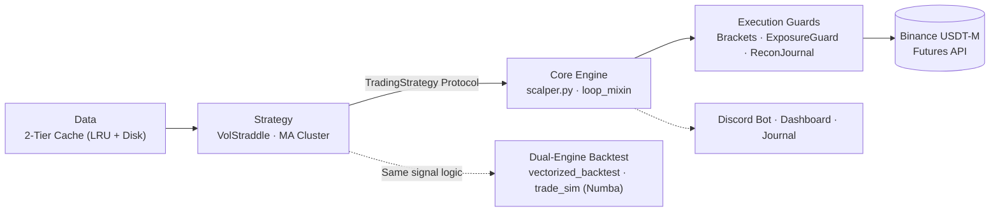

<picture>
  <source media="(prefers-color-scheme: dark)" srcset="docs/images/brand/wordmark-dark.svg">
  
</picture>

**English** | [한국어](README.ko.md)

**Binance USDT-M futures Volatility Ratio Squeeze (VR Squeeze) and MA Cluster breakout trading system — Numba backtesting and live execution share the exact same code path.**

[](https://github.com/younghwan91/quantbox/actions/workflows/ci.yml)
[](https://www.python.org/downloads/)
[](LICENSE)
[](https://www.linkedin.com/in/younghwan-chae/)

> Code for educational and research purposes. Execution results are not presented as evidence of profitability. Strategy parameters are in [docs/STRATEGIES.md](docs/STRATEGIES.md) and `quantbox/strategy/*/config.py`.

- **Dual Volatility Breakout Signals**: `VolStraddle` (15m/1h/4h VR compression + `D_mom8` / `S_d8` straddle) and `MA Cluster Squeeze` (4h SMA 20/50/100/200 convergence breakout) share a unified slot pool.
- **Unified Live & Backtest Path**: Identical `TradingStrategy` Protocol-based signal logic runs across the Numba-accelerated dual backtest engines (`vectorized_backtest.py`, `trade_sim.py`) and the paper/live trading engine.
- **Multi-Layer Live Execution Guards**: Built-in server-side STOP brackets, Limit Chaser, Market Fallback verification, Max Drawdown Breaker, Daily Loss Limit, `ExposureGuard`, and SQLite `ReconJournal`.
- **Operational Visibility**: Includes a real-time Streamlit dashboard, trade journal CLI, and two-way Discord bot & webhook alerts.

---

## Installation & Quick Start

```bash
git clone https://github.com/younghwan91/quantbox.git
cd quantbox

uv sync          # uv recommended (Python 3.13+)
# or: pip install -e .
```

### Environment Variables

API keys, Discord tokens, webhook URLs, and channel IDs are never stored in code or git and are read exclusively from `.env`. If required values are missing or left as placeholders (`your_...`) from `.env.example`, config validation refuses to start (including paper mode). Backtests and unit tests run without environment variables.

```bash
cp .env.example .env   # Fill in BINANCE_API_KEY, BINANCE_API_SECRET, etc. (.env is gitignored)
```

### Paper Trading

```bash
# Paper trading (simulation, no real orders)
python -m quantbox.scalper --strategy vol_straddle --paper

# Run a single cycle
python -m quantbox.scalper --strategy vol_straddle --paper --once
```

Running without `--paper` executes live orders. Before live trading, enable Binance Hedge Mode and configure `.env`. See [MANUAL.md](MANUAL.md) for detailed setup instructions.

### Live Dashboard & Journal CLI

```bash
bash scripts/start_dashboard.sh start   # Start in background (http://localhost:8501, 30s auto-refresh)
bash scripts/start_dashboard.sh status  # Check status
bash scripts/start_dashboard.sh stop    # Stop

python3 scripts/journal.py              # Today's trades + overall summary
python3 scripts/journal.py symbols      # PnL ranking by symbol
python3 scripts/journal.py last 10      # Last 10 trades
python3 scripts/journal.py strategy     # Performance by strategy
```

---

## Architecture Overview



---

## Strategies, Safety Guards & Backtesting

<details>
<summary>Strategy Suite — VolStraddle, MA Cluster Squeeze, Legacy Strategy</summary>

### VolStraddle — VR Compression Detection
- **Volatility Ratio (VR) Compression**: Detects volatility compression when the short-term ATR to long-term ATR ratio drops below a threshold.
- **Multi-Timeframe**: Evaluates 15m/1h/4h signals independently with higher-timeframe priority.
- **D_mom8**: Enters directionally along 8-bar momentum when a compression signal fires.
- **S_d8 Straddle**: Enters both directions simultaneously (Hedge Mode) when compression persists for a configured number of bars.
- **Exits**: Stop-loss, safety-cap take-profit, trailing stop, and maximum holding duration.
- **No Lookahead**: References completed bars only, excluding the in-progress bar.

### MA Cluster Squeeze — 4h Moving Average Convergence Breakout
- **MA Cluster Detection**: Captures breakouts after SMA(20/50/100/200) lines stay tightly converged for a minimum duration.
- **4h Exclusive**: Operates solely on the higher timeframe with minimal overlap against VR signals.
- **Direction & Filters**: Enters in the momentum direction breaking out of the cluster, filtering out stale clusters and weak momentum signals.

### Legacy Strategy (Non-Production)
- **Rubber Band Scalper**: ATR-adaptive mean reversion with volume climax filter (`quantbox/strategy/rubberband/`).

</details>

<details>
<summary>Data Management & Live Trading Safety Guards</summary>

### Data Management
- **2-Tier Caching**: In-memory LRU + compressed disk cache.
- **Multi-Timeframe**: 1m, 5m, 15m, 1h, 4h, 1d.
- **Binance Integration**: Rate limiting and batch fetching.

### Live Execution Safety Guards
- **Server-Side Stop-Loss**: Binance STOP orders guarantee stop protection even during client crashes or network disconnects.
- **Leverage Verification**: Aborts order placement if leverage configuration fails.
- **Limit Chaser & Market Fallback Verification**: Reduces slippage via limit chasing and re-queries ACK responses to prevent phantom fills.
- **State Persistence**: Saves position state to JSON and reconciles against the exchange on crash recovery.
- **Max Drawdown Breaker · Daily Loss Limit**: Halts new entries and liquidates positions if drawdown from session peak or daily loss limit is breached.
- **Consecutive Error Guard · Close Failure Retention**: Liquidates all positions on consecutive errors; retains slot tracking on close failures for retry.
- **Rate Limiter + Circuit Breaker · In-Flight Order Tracker**: Tracks API rate limits and pending orders.
- **ExposureGuard · ReconJournal · Config Validators**: Session exposure caps, SQLite audit log, and cross-field config validation (`SL < TP`, `leverage >= 1`).
- **Discord Bot**: Remote monitoring and commands (position inspection, forced close, etc.).

</details>

<details>
<summary>Backtesting (Dual-Engine)</summary>

- **Signal-Array Engine** (`vectorized_backtest.py`): Fast single-asset scan using `±1` position arrays.
- **Trade-Event Engine** (`trade_sim.py`): Discrete trade simulation with High/Low intrabar SL/TP, N-slot portfolio contention, and Numba acceleration. Pipeline: `sim_directional_trades()` / `sim_straddle_trades()` → `collect_trades()` → `portfolio_sim()` → `compute_metrics()`.
- **Rolling Windows & Metrics**: Formation/Trading period simulation, Sharpe, Sortino, Calmar, Profit Factor, and Bootstrap CI.

</details>

---

## Testing & Project Structure

```bash
uv run pytest tests/ -v
```

| Path | Description |
|---|---|
| `quantbox/core/` | Config (`pydantic-settings`), event loop, state persistence, rate limiter, Discord commands, trade journal |
| `quantbox/execution/` | Server-side brackets, positions, exchange reconciliation, in-flight tracker, exposure cap, preflight, risk guards |
| `quantbox/data/` | Binance downloader, 2-tier cache, data loader |
| `quantbox/strategy/` | `vol_straddle` (VR compression + MA cluster), `rubberband` (legacy), `vol_selector`, `TradingStrategy` Protocol |
| `quantbox/backtest/` | `vectorized_backtest` (signal array), `trade_sim` (trade event) |
| `quantbox/notifications/` | Discord bot (two-way) & webhooks (one-way) |
| `quantbox/utils/` | Diagnostic logging |
| `quantbox/scalper.py` | Core engine entry point |
| `scripts/`, `research/`, `autoresearch/`, `docs/`, `tests/` | Utility scripts, research, docs ([STRATEGIES.md](docs/STRATEGIES.md), [MANUAL.md](MANUAL.md)), tests |

## License & Disclaimer

[MIT](LICENSE) © 2026 Younghwan Chae

This software is intended for **educational and research purposes only**. Cryptocurrency trading carries substantial risk of loss.
