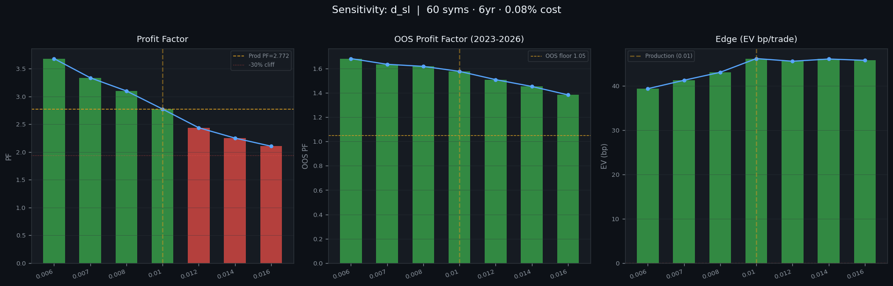
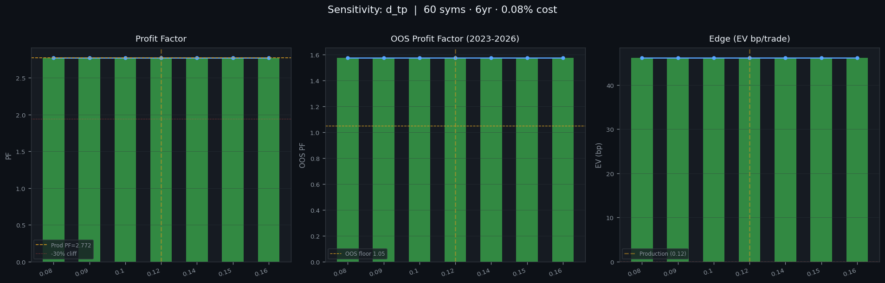
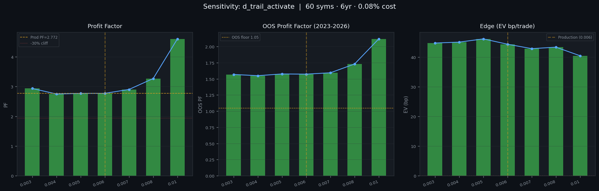
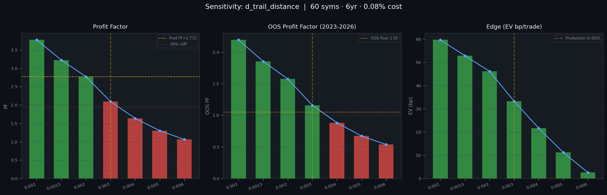
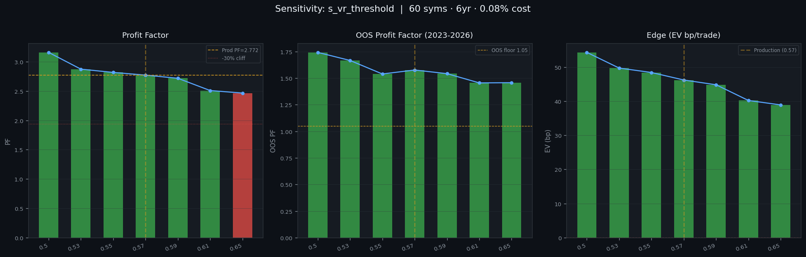
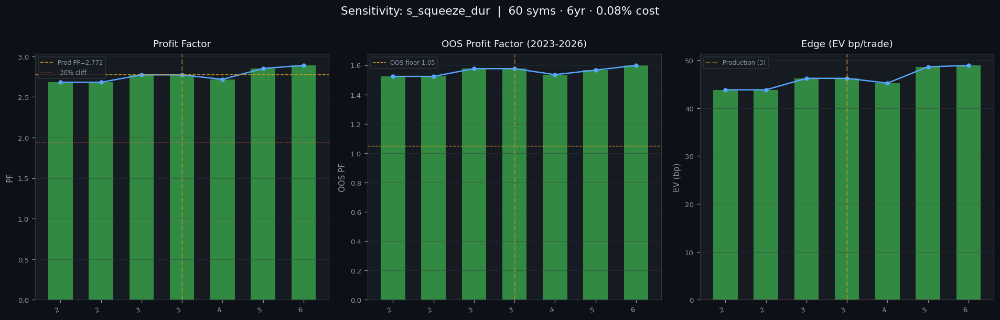
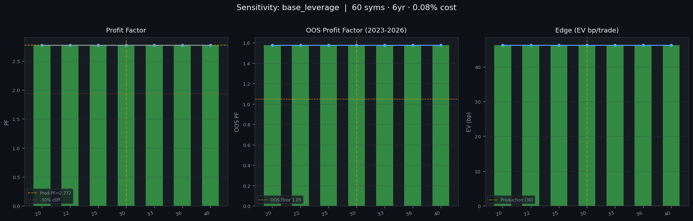

# r67: Parameter Sensitivity Analysis

**Date:** 20260312  |  **Commit:** `a2153e4`

**Data:** 60 syms · 6.0 years (2020-01 – 2026-02) · 0.08% round-trip

**Baseline (production):** N=10388  PF=2.772  EV=46.2bp  OOS_PF=1.576

## Robustness Summary

Pass criterion: ±1-step PF change ≤ ±30% AND OOS PF ≥ 1.05

| | Parameter | Prod Value | Δ -step | Δ +step | OOS lo | OOS hi |
|---|---|---|---|---|---|---|
| ✅ | `d_sl` | 0.01 | +11.8% | -12.1% | 1.617 | 1.508 |
| ✅ | `d_tp` | 0.12 | +0.0% | +0.0% | 1.576 | 1.576 |
| ✅ | `d_trail_activate` | 0.005 | +0.0% | +4.8% | 1.576 | 1.594 |
| ❌ | `d_trail_distance` | 0.002 | +0.0% | -40.9% | 1.576 | 0.883 |
| ✅ | `s_vr_threshold` | 0.57 | +1.7% | -1.9% | 1.539 | 1.542 |
| ✅ | `s_squeeze_dur` | 3 | +0.0% | -2.0% | 1.576 | 1.535 |
| ✅ | `base_leverage` | 30 | +0.0% | +0.0% | 1.576 | 1.576 |

## Detailed Sweeps

### d_sl

| Value | N | PF | EV(bp) | OOS PF | Robust |
|---|---|---|---|---|---|
| 0.006 | 12976 | 3.680 | 39.4 | 1.681 | ❌ |
| 0.007 | 12069 | 3.335 | 41.3 | 1.634 | ✅ |
| 0.008 | 11417 | 3.098 | 43.1 | 1.617 | ✅ |
| 0.01 ★ | 10388 | 2.772 | 46.2 | 1.576 | ✅ |
| 0.012 | 9736 | 2.436 | 45.6 | 1.508 | ✅ |
| 0.014 | 9270 | 2.250 | 46.1 | 1.452 | ✅ |
| 0.016 | 8879 | 2.104 | 45.8 | 1.383 | ✅ |

### d_tp

| Value | N | PF | EV(bp) | OOS PF | Robust |
|---|---|---|---|---|---|
| 0.08 | 10388 | 2.772 | 46.2 | 1.576 | ✅ |
| 0.09 | 10388 | 2.772 | 46.2 | 1.576 | ✅ |
| 0.1 | 10388 | 2.772 | 46.2 | 1.576 | ✅ |
| 0.12 ★ | 10388 | 2.772 | 46.2 | 1.576 | ✅ |
| 0.14 | 10388 | 2.772 | 46.2 | 1.576 | ✅ |
| 0.15 | 10388 | 2.772 | 46.2 | 1.576 | ✅ |
| 0.16 | 10388 | 2.772 | 46.2 | 1.576 | ✅ |

### d_trail_activate

| Value | N | PF | EV(bp) | OOS PF | Robust |
|---|---|---|---|---|---|
| 0.003 | 11679 | 2.937 | 44.8 | 1.568 | ✅ |
| 0.004 | 10890 | 2.751 | 45.1 | 1.549 | ✅ |
| 0.005 | 10388 | 2.772 | 46.2 | 1.576 | ✅ |
| 0.006 ★ | 10085 | 2.773 | 44.4 | 1.573 | ✅ |
| 0.007 | 9877 | 2.904 | 42.9 | 1.594 | ✅ |
| 0.008 | 9751 | 3.272 | 43.4 | 1.730 | ✅ |
| 0.01 | 9676 | 4.606 | 40.5 | 2.119 | ❌ |

### d_trail_distance

| Value | N | PF | EV(bp) | OOS PF | Robust |
|---|---|---|---|---|---|
| 0.001 | 10388 | 3.772 | 59.7 | 2.193 | ❌ |
| 0.0015 | 10388 | 3.223 | 52.9 | 1.854 | ✅ |
| 0.002 | 10388 | 2.772 | 46.2 | 1.576 | ✅ |
| 0.003 ★ | 10383 | 2.095 | 33.3 | 1.160 | ✅ |
| 0.004 | 10364 | 1.639 | 21.7 | 0.883 | ❌ |
| 0.005 | 10328 | 1.301 | 11.2 | 0.673 | ❌ |
| 0.006 | 10263 | 1.065 | 2.6 | 0.538 | ❌ |

### s_vr_threshold

| Value | N | PF | EV(bp) | OOS PF | Robust |
|---|---|---|---|---|---|
| 0.5 | 1874 | 3.160 | 54.3 | 1.742 | ✅ |
| 0.53 | 4017 | 2.874 | 49.7 | 1.666 | ✅ |
| 0.55 | 6514 | 2.818 | 48.4 | 1.539 | ✅ |
| 0.57 ★ | 10388 | 2.772 | 46.2 | 1.576 | ✅ |
| 0.59 | 15962 | 2.718 | 44.8 | 1.542 | ✅ |
| 0.61 | 23842 | 2.509 | 40.2 | 1.455 | ✅ |
| 0.65 | 48011 | 2.466 | 38.9 | 1.457 | ✅ |

### s_squeeze_dur

| Value | N | PF | EV(bp) | OOS PF | Robust |
|---|---|---|---|---|---|
| 2 | 12844 | 2.681 | 43.8 | 1.523 | ✅ |
| 2 | 12844 | 2.681 | 43.8 | 1.523 | ✅ |
| 3 | 10388 | 2.772 | 46.2 | 1.576 | ✅ |
| 3 ★ | 10388 | 2.772 | 46.2 | 1.576 | ✅ |
| 4 | 8577 | 2.717 | 45.2 | 1.535 | ✅ |
| 5 | 7246 | 2.851 | 48.6 | 1.566 | ✅ |
| 6 | 6129 | 2.889 | 48.9 | 1.598 | ✅ |

### base_leverage

| Value | N | PF | EV(bp) | OOS PF | Robust |
|---|---|---|---|---|---|
| 20 | 10388 | 2.772 | 46.2 | 1.576 | ✅ |
| 22 | 10388 | 2.772 | 46.2 | 1.576 | ✅ |
| 25 | 10388 | 2.772 | 46.2 | 1.576 | ✅ |
| 30 ★ | 10388 | 2.772 | 46.2 | 1.576 | ✅ |
| 33 | 10388 | 2.772 | 46.2 | 1.576 | ✅ |
| 36 | 10388 | 2.772 | 46.2 | 1.576 | ✅ |
| 40 | 10388 | 2.772 | 46.2 | 1.576 | ✅ |

## Verdict

**⚠️ CLIFF EDGES FOUND**

**Parity Notes:**
- `symbol_whitelist` used (60 live symbols, not exclude_symbols) ✅
- All params from `VolStraddleConfig()` — no hardcoding ✅
- No lookahead: `_offset` applied, completed bars only ✅
- L/N model: 1x compound (EV_bp is leverage-independent) ✅
